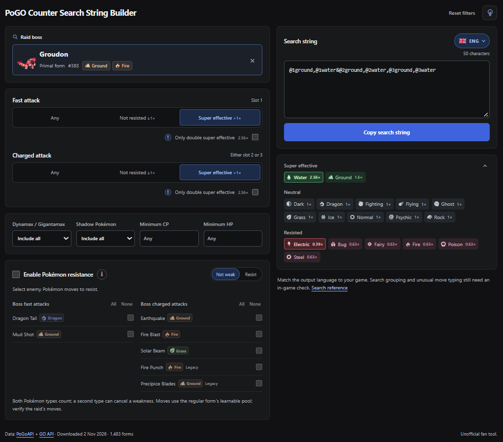

# PoGO Counter Search String Builder

Available at: [nvljn.github.io/pogocounter](https://nvljn.github.io/pogocounter/)



Pick a boss, set attack/resistance and inventory filters, choose your game's language, then copy the result into Pokémon GO's storage search.

## Run locally

Requires Node.js 22.18+; Node.js 24 recommended.

```sh
npm ci
npm run dev
```

Production build and local preview:

```sh
npm run build
npm run preview
```

## Update the data

| Command | Updates |
| --- | --- |
| `npm run update-data` | Pokémon, forms, moves and type chart |
| `npm run update-previews` | Thumbnails |
| `npm run update-languages` | Translated search keywords |
| `npm run update-flags` | Language flags |
| `npm run update-type-icons` | Type icons |

Move data lists learnable attacks, not confirmed raid/event movesets. Select the boss moves you observed in the raid.

## Data and artwork

- Data: [PoGoAPI](https://pogoapi.net/documentation/) and [Pokémon GO API](https://pokemon-go-api.github.io/pokemon-go-api/api/pokedex/mega.json).
- Artwork: [PokéAPI](https://github.com/PokeAPI/sprites) and [PokeMiners](https://github.com/PokeMiners/pogo_assets).
- Translations: [sora10pls](https://github.com/sora10pls/holoholo-text/tree/main/Release). Flags: [flag-icons](https://github.com/lipis/flag-icons). Type icons: [duiker101](https://github.com/duiker101/pokemon-type-svg-icons).

Source dates/hashes are stored with the data; notices are in `public/licenses/`. Unofficial fan tool; Pokémon artwork belongs to its respective rights holders.
